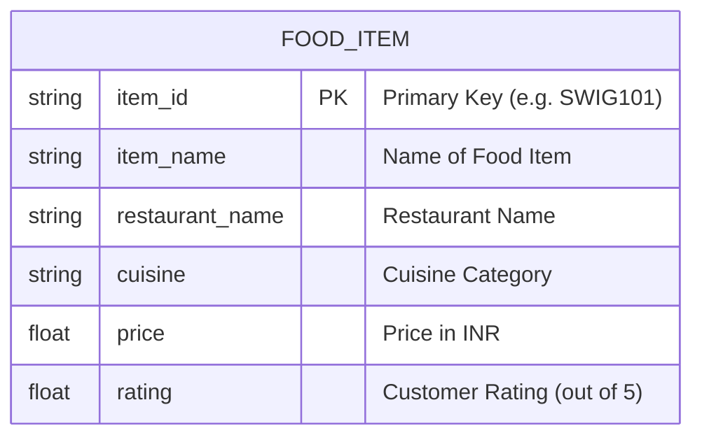

# Ex02 Django ORM Web Application
## Date: 09-10-2026

## AIM
To develop a Django application to manage an online food delivery platform like Zomato/Swiggy using Object Relational Mapping (ORM).

## ENTITY RELATIONSHIP DIAGRAM



## DESIGN STEPS

### STEP 1:
Clone the problem repository from GitHub or create a new Django project and app.

### STEP 2:
Register the app (`'foodapp'`) in `settings.py` under `INSTALLED_APPS`.

### STEP 3:
Define the `FoodItem` model with primary key (`item_id`) and six fields in `foodapp/models.py`.

### STEP 4:
Register `FoodItem` with a custom `ModelAdmin` in `foodapp/admin.py` displaying all fields in `list_display`.

### STEP 5:
Run `python manage.py makemigrations` and `python manage.py migrate` to apply the database schema.

### STEP 6:
Populate the database with 10 records using Django ORM in `python manage.py shell`.

### STEP 7:
Create a view in `views.py` and template in `templates/foodapp/index.html` to display the food items on the web page.

---

## PROGRAM

### `foodapp/models.py`
```python
from django.db import models

class FoodItem(models.Model):
    item_id = models.CharField(max_length=20, primary_key=True)
    item_name = models.CharField(max_length=100)
    restaurant_name = models.CharField(max_length=100)
    cuisine = models.CharField(max_length=50)
    price = models.FloatField()
    rating = models.FloatField()

    def __str__(self):
        return f"{self.item_name} ({self.restaurant_name})"
```

### `foodapp/admin.py`
```python
from django.contrib import admin
from .models import FoodItem

class FoodItemAdmin(admin.ModelAdmin):
    list_display = ('item_id', 'item_name', 'restaurant_name', 'cuisine', 'price', 'rating')
    search_fields = ('item_name', 'restaurant_name', 'cuisine')
    list_filter = ('cuisine', 'restaurant_name')

admin.site.register(FoodItem, FoodItemAdmin)
```

### `foodapp/views.py`
```python
from django.shortcuts import render
from .models import FoodItem

def food_list(request):
    items = FoodItem.objects.all()
    return render(request, 'foodapp/index.html', {'items': items})
```

### `myproject/urls.py`
```python
from django.contrib import admin
from django.urls import path
from foodapp import views as food_views

urlpatterns = [
    path('admin/', admin.site.urls),
    path('', food_views.food_list, name='food_list'),
]
```

---

## OUTPUT

### ORM QuerySet Output (`python manage.py shell`)
```text
>>> from foodapp.models import FoodItem
>>> FoodItem.objects.values()
<QuerySet [
  {'item_id': 'SWIG101', 'item_name': 'Chicken Dum Biryani', 'restaurant_name': 'Paradise Biryani', 'cuisine': 'Hyderabadi', 'price': 299.0, 'rating': 4.5},
  {'item_id': 'SWIG102', 'item_name': 'Paneer Butter Masala', 'restaurant_name': 'A2B Veg Restaurant', 'cuisine': 'North Indian', 'price': 240.0, 'rating': 4.3},
  {'item_id': 'SWIG103', 'item_name': 'Ghee Podi Masala Dosa', 'restaurant_name': 'Saravana Bhavan', 'cuisine': 'South Indian', 'price': 110.0, 'rating': 4.7},
  {'item_id': 'SWIG104', 'item_name': 'Cheese Burst Margherita Pizza', 'restaurant_name': "Domino's Pizza", 'cuisine': 'Italian', 'price': 199.0, 'rating': 4.2},
  {'item_id': 'SWIG105', 'item_name': 'Crispy Veg Double Whopper', 'restaurant_name': 'Burger King', 'cuisine': 'Fast Food', 'price': 179.0, 'rating': 4.1},
  {'item_id': 'SWIG106', 'item_name': 'Schezwan Chicken Fried Rice', 'restaurant_name': 'Mainland China', 'cuisine': 'Chinese', 'price': 235.0, 'rating': 4.4},
  {'item_id': 'SWIG107', 'item_name': 'Amritsari Chole Bhature', 'restaurant_name': "Haldiram's", 'cuisine': 'North Indian', 'price': 160.0, 'rating': 4.6},
  {'item_id': 'SWIG108', 'item_name': 'McSpicy Chicken Burger Meal', 'restaurant_name': "McDonald's", 'cuisine': 'Fast Food', 'price': 220.0, 'rating': 4.0},
  {'item_id': 'SWIG109', 'item_name': 'South Indian Filter Coffee', 'restaurant_name': 'Madras Coffee House', 'cuisine': 'Beverages', 'price': 45.0, 'rating': 4.8},
  {'item_id': 'SWIG110', 'item_name': 'Dark Chocolate Overload Waffle', 'restaurant_name': 'The Belgian Waffle Co.', 'cuisine': 'Desserts', 'price': 150.0, 'rating': 4.7}
]>
```

---

## RESULT
Thus, a Django application to manage an online food delivery platform like Zomato/Swiggy using Object Relational Mapping (ORM) was successfully developed and populated with ten records.
